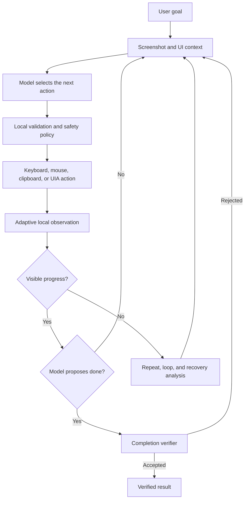

# RDPilot

**A resilient, open-source Windows desktop agent that sees the screen, operates
real applications, verifies results, recovers from failures, and remembers what
worked.**

[](https://www.microsoft.com/windows)
[](https://dotnet.microsoft.com/)
[](LICENSE.txt)
[](https://github.com/carpptn/RDPilot/actions/workflows/ci.yml)

RDPilot is an experimental C#/.NET application that lets a multimodal AI control
the visible Windows desktop through screenshots, keyboard, mouse, clipboard, and
UI Automation metadata. It is built for experiments with reliable, long-running
desktop automation rather than browser-only scripting.

> [!WARNING]
> RDPilot controls your real mouse and keyboard and can act unpredictably. Start
> in a disposable VM or a non-critical environment. Press **Ctrl+Alt+Q** to abort
> the current run immediately.

## Why RDPilot?

A basic desktop agent repeatedly sends a screenshot to a model and executes the
next click. RDPilot adds a reliability layer around that loop:

| Typical desktop-agent behavior | RDPilot |
| --- | --- |
| Uses a fixed delay after every action | Adapts observation and settling to the current UI |
| Repeats an ineffective click or key | Detects repeats, rejected proposals, and wider state cycles |
| Trusts the model when it says the task is done | Runs a separate completion verification step |
| Loses recovery knowledge after exit | Persists verified recovery strategies between runs |
| Treats recurring states as failures | Distinguishes harmful loops from productive continuous work |
| Requests a new model decision after every input | Safely batches bounded deterministic sequences |
| Assumes every task has a natural ending | Supports both finite and continuous goals |

RDPilot can locally observe the result of reversible inputs, preserve causal
before/after evidence, change observation profiles as the situation changes, and
feed verified failures back into the next decision.

## What can it do?

- Complete multi-step tasks across normal Windows applications.
- Inspect unfamiliar interfaces and choose actions from visual evidence.
- Detect ineffective actions and recover from direct or multi-step loops.
- Remember successful recovery strategies and quarantine repeatedly failing ones.
- Verify that a finite task is actually complete before stopping.
- Monitor an application and react to new events in continuous mode.
- Draw, drag, pan, operate sliders, use lasso gestures, and hold keys.
- Interact with turn-based puzzles and simple realtime applications.
- Use an opt-in multi-monitor virtual desktop, including negative coordinates.
- Analyze the current screen with the interactive `/ask` command.
- Optionally use hosted web search or explicitly enabled high-level local actions.

## Quick start

### Requirements

- Windows 10 or Windows 11
- [.NET 10 SDK or Desktop Runtime](https://dotnet.microsoft.com/en-us/download/dotnet/10.0): the SDK is required to build from source; the Desktop Runtime alone is sufficient for a portable release
- An OpenAI API key

### Run a portable release

1. Download the `RDPilot-*-win-x64-portable.zip` archive from the
   [latest release](https://github.com/carpptn/RDPilot/releases/latest).
2. Extract the archive to a writable directory.
3. Set your API key and start RDPilot:

```powershell
$env:OPENAI_API_KEY = "sk-..."
.\RDPilot.exe
```

### Run from source

```powershell
git clone https://github.com/carpptn/RDPilot.git
cd RDPilot
$env:OPENAI_API_KEY = "sk-..."
dotnet run --project .\RDPilot
```

All 145 runtime settings are available in
[`RDPilot/appsettings.json`](RDPilot/appsettings.json). The file is copied next
to `RDPilot.exe` during build and publish, so users can change normal runtime
configuration without editing code or defining environment variables. Keep the
API key in `OPENAI_API_KEY`; it is intentionally not stored in the JSON file.

Enter a goal at the interactive prompt:

```text
open Notepad and type a short summary of what is visible on the screen
```

Run one task non-interactively:

```powershell
dotnet run --project .\RDPilot -- --task "open Notepad and type hello"
```

Build a release:

```powershell
dotnet build -c Release
```

RDPilot stores screenshots, request/response payloads, logs, and recovery memory
next to the built executable.

## Example goals

These examples illustrate the intended interaction modes. Results depend on the
selected model, application state, display layout, and task complexity. Supervise
every run.

### Desktop workflow

```text
Read the values visible in the open document, enter them into the open
spreadsheet, calculate the total, and save the workbook.
```

### Unfamiliar interface

```text
Inspect the visible puzzle, infer how its controls work, and solve it.
```

### Drawing and gestures

```text
Reproduce the simple drawing visible on the left side of the screen in the open
Paint canvas.
```

### Continuous task

```text
Keep monitoring this window. When a new completed item appears, move it to the
Done column. Continue until I stop the run.
```

### Screen question

```text
/ask which application currently has keyboard focus?
```

## How it works



1. RDPilot classifies the goal as finite or continuous.
2. It captures the primary display, or the full virtual desktop when explicitly
   enabled, and collects focused UI Automation context.
3. The model returns a strict JSON action sequence.
4. RDPilot validates the proposed actions before sending real input.
5. Local observation measures the effect of selected reversible inputs.
6. The loop continues until completion is verified, the user aborts, or a
   configured safety guard stops the run.

## Recovery and persistent memory

RDPilot does not automatically treat a failed interaction as a reason to repeat
the same model call and click.

The runtime tracks visual and semantic state, action families, focused UI
context, observed screen changes, and rejected action proposals. It can detect
fixed and variable-length cycles, temporarily block ineffective actions, and
request a different strategy.

When a candidate recovery strategy produces independently verified progress,
RDPilot can store a contextual lesson in persistent recovery memory. Lessons are
ranked using reliability, relevance, reward, recency, uncertainty, and cost.
Repeated confirmed failures move a lesson into quarantine instead of allowing it
to keep influencing future runs.

Recovery memory is local and bounded. Raw sensitive action text and UI context
are redacted or token-hashed in replay telemetry.

## Interaction model

RDPilot's action schema includes:

- Text and keyboard: `paste_text`, `type_text`, `keys`, `hold_keys`
- UI Automation: `focus_uia`, `click_uia`
- Pointer input: `move`, `click`, `double_click`, `scroll`
- Gestures: `drag_drop`, `drag_path`
- Visual inspection: `request_crop`, `point`, `aim`
- Control flow: `wait`, `done`
- Opt-in high-level actions: `open_url`, `launch_app`, `run_command`

High-level local actions and command execution are disabled unless the operator
explicitly enables them. Continuous goals do not expose the `done` action to the
model.

## Runtime modes

Runtime profiles provide a starting point for speed and quality:

```powershell
RDPilot.exe --profile fast
RDPilot.exe --profile balanced
RDPilot.exe --profile quality
```

Observation begins in a general profile and may adapt to:

- static UI,
- local editing,
- event-driven applications,
- streaming output,
- turn-based interaction,
- realtime interaction.

Common options:

| Purpose | Option |
| --- | --- |
| Select model | `--model <model>` |
| Set reasoning effort | `--effort <level>` |
| Run exactly one task | `--task "<goal>"` |
| Choose finite or continuous mode | `--goal-mode <mode>` |
| Enable the virtual multi-monitor desktop | `--multi-monitor` |
| Disable mouse actions | `--no-mouse` |
| Enable hosted web search | `--allow-web-search` |
| Enable URL and application launch actions | `--allow-high-level-actions` |
| Enable local command execution | `--allow-run-command` |
| Set the control-step limit | `--max-steps <n>` |

Configuration is applied in this order: code defaults, `appsettings.json`, a
file selected with `RDPILOT_CONFIG`, environment variables, and CLI flags. An
`appsettings.json` file in the working directory is preferred over the copy next
to the executable.

See the [complete technical reference](docs/technical-reference.md) for every
environment variable, CLI flag, JSON setting, runtime profile, diagnostic mode,
and replay option.

## Safety model

RDPilot is an experimental research project, not a security boundary.

- Use a disposable VM or non-critical Windows account.
- Keep sensitive applications, credentials, and private information out of view.
- Treat text visible in webpages and documents as untrusted prompt-injection
  input.
- Supervise consequential tasks and verify their results yourself.
- High-level navigation and command execution remain opt-in.
- Web search is disabled by default and logged when used.
- Multi-monitor capture and control are opt-in.
- The control loop validates coordinates, action bounds, gesture duration, and
  supported key combinations.
- Press **Ctrl+Alt+Q** to cancel in-flight requests, waits, delays, and input.

No guard can make arbitrary model-generated desktop automation completely safe.

## Output and diagnostics

Runtime artifacts are stored below the directory containing `RDPilot.exe`:

| Directory | Contents |
| --- | --- |
| `screens` | Full screenshots, crops, focus images, and aim overlays |
| `requests` | Model request and response payloads |
| `logs` | Per-run console logs |
| `memory` | Prompt history, recovery memory, telemetry, and replay corpus |

RDPilot can analyze retained logs, reconstruct saved API requests, and replay
labelled loop-detection cases without operating the desktop. See
[Testing and diagnostics](docs/technical-reference.md#testing-and-diagnostics).

## Testing

Run the deterministic self-test suite without desktop interaction or an API key:

```powershell
dotnet run --project .\RDPilot.SelfTests\RDPilot.SelfTests.csproj -c Release
```

The current suite contains 71 tests covering action validation, coordinate
mapping, multi-monitor behavior, prompt history, streaming responses, adaptive
observation, gestures, finite and continuous goals, loop detection, recovery
memory, telemetry, replay, retention, concurrency, and corruption recovery.

## Project status

| Area | Status |
| --- | --- |
| Windows 10/11 | Supported target |
| Primary display | Default capture and control mode |
| Multi-monitor | Experimental, explicit opt-in |
| Mouse, keyboard, clipboard, and UIA | Supported |
| Gestures and held keys | Supported |
| Persistent recovery memory | Supported |
| Hosted OpenAI models | Supported |
| Local or provider-independent models | Not currently supported |
| macOS and Linux | Not supported |
| Production-critical workflows | Not recommended |

RDPilot is developed for exploration, testing, and learning. API latency, model
behavior, changing interfaces, display scaling, permissions, animations, and
modal dialogs can all affect results.

## Documentation

- [Default application settings](RDPilot/appsettings.json)
- [Complete configuration and command reference](docs/technical-reference.md)
- [Testing and offline diagnostics](docs/technical-reference.md#testing-and-diagnostics)
- [Runtime and observation profiles](docs/technical-reference.md#runtime-and-observation-profiles)
- [Safety, limitations, and disclaimer](docs/technical-reference.md#safety-limitations--disclaimer)
- [Contributing guide](CONTRIBUTING.md)
- [Security policy](SECURITY.md)
- [Project roadmap](ROADMAP.md)

## Contributing

Issues and pull requests are welcome. See [CONTRIBUTING.md](CONTRIBUTING.md) for
the development workflow, testing requirements, and guidance for safely sharing
diagnostic artifacts.

## License

RDPilot is licensed under the GNU Affero General Public License v3.0
(`AGPL-3.0-only`). See [LICENSE.txt](LICENSE.txt).

For closed-source redistribution, OEM embedding, or a proprietary hosted
offering, contact the repository owner about separate commercial licensing.
